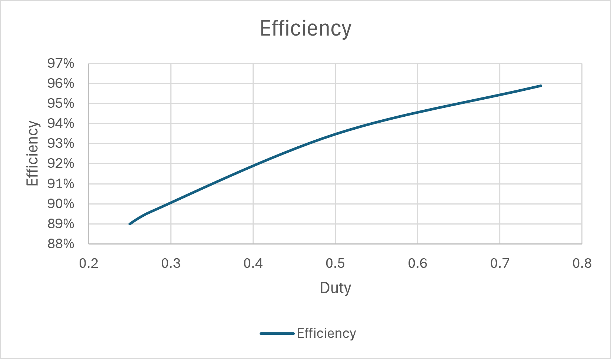

# Digitally-Controlled Buck Converter

A buck converter where the switching signal comes from Verilog instead of an
off-the-shelf controller chip. I sized the PWM resolution from a spec,
synthesized it to get a gate count, used the result to drive a buck converter
power stage in SPICE, and then checked the measured output against a loss
model I worked out from the component datasheet parameters.

The two halves aren't separate projects. The PWM resolution I settle on in
Part 2 sets the switching frequency, and that frequency is what sizes the
inductor and capacitor in Part 3. Change one and the other has to change too.

**Tools:** Icarus Verilog 0.9.7, GTKWave, Yosys 0.69, LTspice 26.0.1

---

## Contents

* [Headline results](#headline-results)
* [How the pieces fit together](#how-the-pieces-fit-together)
* [Part 1 — PWM generator in Verilog](#part-1--pwm-generator-in-verilog)
* [Part 2 — Picking the resolution](#part-2--picking-the-resolution)
* [Part 3 — Buck converter in SPICE](#part-3--buck-converter-in-spice)
* [Part 4 — Where the missing voltage goes](#part-4--where-the-missing-voltage-goes)
* [Part 5 — Efficiency](#part-5--efficiency)
* [Why the output never hits its target](#why-the-output-never-hits-its-target)
* [How I used AI on this](#ai-to-accelerate-workflow)
* [What this project doesn't cover](#what-this-project-doesnt-cover-out-of-scope)
* [What I'd do next](#what-id-do-next-future-scope)
* [Running it yourself](#running-it-yourself)
* [Repository layout](#repository-layout)
* [References](#references)

---

## Headline results

|||
|-|-|
|Best PWM resolution|**9 bits** — the only width that passes both specs|
|Switching frequency that falls out of it|195.3 kHz|
|Gate count at 9 bits|59 cells|
|How area grows|about 7 cells per extra bit|
|Testbench|every duty setting matched exactly, no tolerance band|
|Output voltage error, open loop|272 to 293 mV below ideal|
|Loss model vs. measurement|agrees within 1.6 mV|
|Best efficiency|95.9% at D = 0.75|

---

## How the pieces fit together

```
  duty[8:0] ──►  ┌──────────────────┐
                 │  pwm_generator   │  counter + comparator
    100 MHz ───► │     (Verilog)    │  f_sw = f_clk / 2^WIDTH
                 └────────┬─────────┘
                          │ pwm_out
                          ▼
        Vin ──────────[ switch ]──────┬─────[ L ]────┬──── Vout
       12 V                           │              │
                                   [ diode ]      [ C ]   [ load ]
                                      │              │       │
                                     GND            GND     GND
```

The Verilog block decides the duty cycle. The power stage turns that duty
cycle into an output voltage. Everything here is about how well that
conversion actually works, and where it falls short.

---

## Part 1 — PWM generator in Verilog

### The design

Two pieces: a counter that free-runs, and a comparator. The counter counts up
every clock and wraps around on its own when it overflows. The output is high
whenever the count is below whatever number is sitting in `duty`.

```verilog
always @(posedge clk or negedge reset_n) begin
    if (!reset_n) 
        counter <= {WIDTH{1'b0}};
    else        
        counter <= counter + 1'b1;
end

assign pwm_out = (counter < duty);
```

That's the whole thing. No reset-on-max logic is needed because the counter
is exactly `WIDTH` bits wide, so it rolls over by itself.

### The equations everything else depends on

|What|Formula|
|-|-|
|Duty cycle|`D = duty / 2^WIDTH`|
|Switching frequency|`f_sw = f_clk / 2^WIDTH`|
|Smallest output voltage step|`V_step = Vin / 2^WIDTH`|
|Worst-case error from stepping|`V_err = V_step / 2 = Vin / 2^(WIDTH+1)`|
|Largest duty you can reach|`D_max = (2^WIDTH − 1) / 2^WIDTH`|

### Why the design can't do 100% duty

A counter-and-comparator PWM can never hold its output high for a whole
period. At 8 bits the biggest number you can load is 255, which gives
255/256 = 99.61%. There's always one count per period where the output is low.

On a buck converter that means the output voltage can never reach the
input voltage. It's why real controllers include a bypass or "100% mode" for
when the input sags close to the output.

You can see it in the GTKWave capture — at `duty = 255` there's a thin notch
at the end of the oscillation.

### Checking that it works

The testbench checks itself instead of asking me to eyeball a waveform. For
each duty setting it watches the output on every clock for exactly `2^WIDTH`
cycles, counts how many of those the output was high, and compares that count
to the number it loaded.

The comparison is exact — there's no "within 5%" tolerance anywhere in it.
That's deliberate and it's justified. Over one full period the counter hits
every value from 0 to `2^WIDTH − 1` exactly once, so the number of high clocks
has to equal `duty` precisely. Sampling over a whole number of periods also
means the answer doesn't depend on where in the period you started counting.

|duty|Expected|Measured|High clocks|
|-|-|-|-|
|0|0.00%|0.00%|0|
|64|25.00%|25.00%|64|
|128|50.00%|50.00%|128|
|192|75.00%|75.00%|192|
|255|99.61%|99.61%|255|

`RESULT: all checks PASSED`


---

## Part 2 — Picking the resolution

More bits means finer control over the output voltage, which is good. But more
bits also means a longer counter period, which drops the switching frequency,
and that's bad. Both effects come from the same counter.

### The two specs:

|Spec|Number|Why|
|-|-|-|
|Output accuracy|±0.5% of 3.3 V, so `V_err ≤ 16.5 mV`|Point-of-load regulators usually get specced somewhere between ±1% and ±3% overall. That budget also has to cover reference drift and feedback divider tolerance (not applicable for this project), load regulation (calculated below) and ripple — so the PWM should only eat a small slice of it.|
|Switching frequency|`f_sw ≥ 100 kHz`|Go much below 100 kHz and the inductor and capacitor both have to get bigger, and the switching noise starts creeping into the audible range.|

Everything below assumes `Vin = 12 V` and `f_clk = 100 MHz`.

### Synthesis numbers

Run through Yosys with `synth -top pwm_generator`, cell counts read off `stat`.

|WIDTH|Cells|Flip-flops|V\_step (mV)|Worst error (mV)|f\_sw (kHz)|Error ≤ 16.5 mV|f\_sw ≥ 100 kHz|
|-|-|-|-|-|-|-|-|
|6|41|6|187.5|93.8|1562.5|no|yes|
|8|51|8|46.9|23.4|390.6|no|yes|
|**9**|**59**|**9**|**23.4**|**11.7**|**195.3**|**yes**|**yes**|
|10|67|10|11.7|5.9|97.7|yes|no|
|12|84|12|2.9|1.5|24.4|yes|no|
|14|99|14|0.7|0.4|6.1|yes|no|

One thing worth pointing out: the flip-flop count is exactly `WIDTH` at every
single row. That confirms the synthesizer built one register per counter bit
and nothing extra. The rest of the cells are the +1 adder and the comparator,
and both of those grow with bit count, which is why the total climbs in a
straight line at roughly 7 cells per bit.

Cell counts depend on the Yosys version — these came from 0.69. Someone
running a different version will get slightly different numbers.


### The window


**9 bits is the only width that passes both specs.** Anything smaller is not precise for voltage; anything larger drops below the frequency floor.

### Why the window is so tight

Look at what the two constraints actually depend on:

```
V_err = Vin / 2^(WIDTH+1)      ∝ 2^(−WIDTH)
f_sw  = f_clk / 2^WIDTH        ∝ 2^(−WIDTH)
```

They scale the same way. On a log plot they're **parallel lines**. Adding a
bit moves both of them by the same factor, so changing WIDTH doesn't let you
trade accuracy against frequency.

Which means: the only way to open the window is to move something that
affects one line and not the other. The clock frequency only moves `f_sw`. The
input voltage only moves `V_err`. Those are the two real knobs.

### What happens if someone asks for a higher switching frequency

Suppose the spec became ±0.5% accuracy **and** 200 kHz minimum. That's
impossible at a 100 MHz clock. Nine bits gives 195.3 kHz, which misses by
4.7 kHz — 2.3% short. Ten bits fixes the accuracy but collapses to 97.7 kHz.
There's no 9.5-bit option.

Two honest ways out:

1. **Speed up the clock.** You need `f_clk ≥ 200 kHz × 2^9 = 102.4 MHz`. A
2.4% bump in clock rate solves something no amount of bit-fiddling could.
The cost is more dynamic power and tighter timing margins everywhere else.
2. **Go back and talk about the spec.** Consider missing a frequency floor by 2.3%.

---

## Part 3 — Buck converter in SPICE

### Where the operating point comes from

The switching frequency is what the 9-bit
result gave me: **195.3 kHz**, so a period of `T = 5.12 µs`. The analog design
is downstream of the digital one.

### Calculation for the parts:

**Inductor.** The standard starting point is to let the ripple current be about
30% of the output current. At 1 A out that's 0.3 A of ripple.

```
L = (Vin − Vout) × D / (f_sw × ΔI_L)
  = (12 − 3.3) × 0.275 / (195,312 × 0.3)
  = 40.8 µH   →   47 µH   (nearest standard value, rounded up)
```

I rounded up rather than down on purpose. More inductance means less ripple,
so rounding up keeps you inside spec instead of just outside it.

**Output capacitor**, sized for 20 mV of output ripple:

```
C = ΔI_L / (8 × f_sw × ΔV_out)
  = 0.26 / (8 × 195,312 × 0.02)
  = 8.3 µF   →   10 µF
```

**Both formulas follow TI's application note SLVA477C (linked at the bottom).**

**An unexpected connection between the two halves.** The 20 mV
ripple target sits right next to the 23.4 mV voltage step you get at 9 bits.
So the output is physically wobbling by about one step of the finest control
I have. Asking for more PWM resolution would be pointless - the ripple would
consume it. The analog side and the digital side independently landed on the
same answer.

### Parasitics

I left these in rather than using ideal parts, because every one of them shows
up in the measurements:

|Element|Value|
|-|-|
|Inductor DCR|50 mΩ|
|Capacitor ESR|20 mΩ|
|Switch on-resistance|30 mΩ|
|Schottky diode|`Is=1e-5, Rs=0.01, N=1.2` → about 0.36–0.41 V forward drop|
|Load|3.3 Ω, which draws roughly 1 A at 3.3 V|

The Schottky diode was used based on the recommendation of the TI Application Note.


### Measurements

Steady state, averaged from 1.9 ms to 2.0 ms.

|D|Ideal Vout (V)|Measured Vout (V)|Shortfall (mV)|Vout_pp (mV)|ΔI_L theory (A)|ΔI\_L measured (A)|
|-|-|-|-|-|-|-|
|0.250|3.000|2.7074|292.6|16.8|0.2482|0.2536|
|0.275|3.300|3.0084|291.6|17.7|0.2637|0.2693|
|0.500|6.000|5.7149|285.1|22.0|0.3292|0.3364|
|0.750|9.000|8.7279|272.1|16.7|0.2467|0.2509|

The shortfall column is just ideal minus measured.


### Ripple current doesn't just grow with duty cycle

This one surprised me at first. Ripple at D = 0.75 came out *lower* than at
D = 0.5, which looked like a bug until I derived it:

```
ΔI_L = Vout × (1 − D) / (L × f_sw)
```

Substitute `Vout ≈ D × Vin` and you get `ΔI_L ∝ D × (1 − D)` - a parabola.
Zero at both ends, **biggest at D = 0.5**. My measurements at D = 0.25 and
D = 0.75 differ by only 2.7 mA, which is what symmetry about 0.5 would suggest.

Measured values sit 1–2% above theory everywhere. That's consistent and it has
a cause: the actual voltage across the inductor during the off-time includes
the DCR drop, which the simple formula leaves out.

**What this means practically:** size the inductor for D = 0.5 no matter where
the converter normally runs, because that's the **worst case.**


---

## Part 4 — Where the missing voltage goes

The gap between `D × Vin` and what I measured isn't noise. It is these 4 things:

```
Vout = D_eff × Vin − (1 − D_eff) × V_f − I_out × R_DCR − D_eff × I_out × R_on
       └ ideal ┘     └ diode ┘           └ winding ┘      └ switch ┘
```

* **`(1 − D_eff) × V_f`** — when the switch opens, the inductor won't let its
current stop. The only path left is through the freewheel diode, which drags
the switch node *below ground* by its forward drop. You can see this
directly in the transient captures: `V(sw)` sits around −0.367 V for the
whole off-time.
* **`I_out × R_DCR`** — the resistance of the inductor winding. Always there.
* **`D_eff × I_out × R_on`** — loss in the switch, only while it's conducting.
* **`D_eff`** rather than `D` — see below.


### Two corrections I had to make

My first version of this model used a fixed 0.33 V diode drop, and it agreed
with measurement to about 7.5 mV. Then I zoomed into `V(sw)` and measured
−0.367 V, which didn't match. Chasing that gap found two real effects:

**The diode drop isn't constant.** It follows the diode equation
`V_f = N·V_T·ln(I/I_s) + I·R_s`, so it climbs with current. Across the four
operating points it goes 0.359 V → 0.364 V → 0.392 V → 0.414 V.

**The PWM edges stretch the duty cycle slightly.** The switch model flips at
`Vt = 2.5 V`, which is exactly halfway up the 5 V pulse, and the rise and fall
times are 10 ns each. So the switch is really on for `D·T + 10 ns`, making the
effective duty (`D_eff`) 0.27695 instead of 0.275. That's tiny, but it's worth about
24 mV of output, and the old fixed 0.33 V figure was quietly absorbing it.

### The model against the measurements

|D|I\_out (A)|V\_f (V)|Diode (mV)|DCR (mV)|Switch (mV)|Edge gain (mV)|Predicted (mV)|Measured (mV)|Error (mV)|
|-|-|-|-|-|-|-|-|-|-|
|0.250|0.820|0.359|268.8|41.0|6.2|−24.1|292.0|292.6|−0.6|
|0.275|0.912|0.364|262.9|45.6|7.6|−24.1|291.9|291.6|+0.3|
|0.500|1.732|0.392|195.1|86.6|26.1|−24.1|283.7|285.1|−1.4|
|0.750|2.645|0.414|102.7|132.2|59.7|−24.1|270.5|272.1|−1.6|

**Agrees within 1.6 mV**, against shortfalls of around 290 mV. Predicting a
290 mV effect to within 2 mV from datasheet parameters is the result I'm
happiest with in this project.

### Why the total barely moves

Two of the terms pull in opposite directions and nearly cancel:

* The **diode term falls** from 269 mV to 103 mV as duty rises, because the
diode conducts for a smaller slice of each period.
* The **resistive terms climb** from 47 mV to 192 mV, because my load is a
fixed 3.3 Ω resistor, so higher output voltage means more current, and
resistive losses scale with current.

The near-flat total is a coincidence of this particular load, not something
true about buck converters. Put a constant-current load on it and the
cancellation disappears.

### A measurement detail that cost me some confusion

My averaging window is 100 µs, which at 5.12 µs per period is 19.53 switching
periods — not a whole number. For `Vout` that doesn't matter, because the
ripple is only 17 mV so the error is well under a millivolt.

But when I tried averaging `V(sw)`, which swings the full 12 V, the partial
period threw the answer off by about 80 mV and the numbers stopped making
sense. Averaging over exactly 20 periods instead makes
`avg(V_sw) − Vout = I_out × R_DCR` hold to within 31 µV, which is the physics
being exactly right.

Same principle the testbench uses: measure over a whole number of periods else ignore it.

---

## Part 5 — Efficiency

```
Efficiency = η = P_out / P_in = (Vout² / R_load) / (Vin × I_in)
```

|D|P_out (W)|I_in (A)|P_in (W)|η|
|-|-|-|-|-|
|0.250|2.221|0.2080|2.496|89.0%|
|0.275|2.743|0.2551|3.061|89.6%|
|0.500|9.897|0.8824|10.589|93.5%|
|0.750|23.084|2.0063|24.076|95.9%|



Efficiency improves as duty goes up because the diode - the biggest loss at
low duty - spends less time conducting.

**NOTE:** Because the load is a fixed 3.3 Ω
resistor, output power swings from 2.2 W to 23.1 W across this sweep. So this
curve mixes two variables at once, and it isn't a normal efficiency curve — a
proper one sweeps load current while holding output voltage fixed. The effect
it shows is real, but the axis isn't the standard one.

---

## Why the output never hits its target

Ask for D = 0.275 expecting 3.3 V and you get 3.008 V. That's 8.8% low.

You can't fix this by picking a smarter fixed duty value, because the error
moves. Change the load, the input voltage, the temperature, or swap in parts
from a different batch, and the shortfall changes with it.

You also can't fix it by adding a compensating voltage source in series.
Anything sitting in that path carries the full load current — 2.6 A at
D = 0.75 — while dropping voltage across itself. That's a linear regulator,
and it burns as heat exactly the power a switching converter exists to save.

**The actual fix is a feedback loop:**

```
  Vref ──►(+)──► compensator ──► duty[8:0] ──► PWM ──► power stage ──┬──► Vout
           ▲         (PI/PID)                                        │
           │                                                         │
           └──────────── ADC ◄──── resistor divider ◄────────────────┘
```

The loop never has to know *why* the output is low. It only sees that it's
below target and pushes the duty up until the error goes away (Diode drop,
winding resistance, a sagging input, a load step, parts aging, etc.).

**The PWM generator in this repo is the last stage of that loop.** The
resolution study, the frequency constraint, the 9-bit answer — all of it is
sizing the part that does the actual work. The 290 mV error measured here is
the reason to go build the rest.

---

## AI to accelerate workflow

I used Claude as a design-review partner and to generate the testbench. The
RTL I wrote myself against a spec. What kept the project honest wasn't the
model, it was having two independent ways to check every number: an exact
testbench assertion on the digital side, and a loss model on the
analog side.

Human-in-the-Loop: Navigating AI Hallucinations & Corrections

* **A model that fit for the wrong reason.** The first loss model used a fixed
0.33 V diode drop and matched measurement to 7.5 mV, which looked fine. It
was wrong. The real diode drop is 0.35–0.37 V and varies with current, and
the fixed value was silently absorbing a separate 24 mV error from PWM edge
timing. Two mistakes were cancelling. Zooming into the waveform and
measuring the actual drop is what exposed it, and the corrected model agrees
much better.
* **A simulation setup error that looked like a circuit error.** The first
`.tran` directive put the maximum timestep in the wrong argument slot, so
LTspice saved no data inside the measurement window and all three `.meas`
statements failed. Nothing was wrong with the circuit. The only way to find
it was reading the log.
* **A conclusion that was right about the data and wrong about the design.**
An early read of the synthesis numbers said resolution is cheap, since area
only grows linearly. True, and useless - the binding constraint is switching
frequency, not gate count. The gate-count data on its own points the wrong
way.

The workflow: I accepted generated work only where I had an independent check —
an exact assertion, a closed-form model, or a second simulator. Every number
in this README traces back to a file in this repository.

---

## What this project doesn't cover (Out of scope)

* **No feedback loop.** Everything here is open loop. That's the whole
motivation for the next phase, not an oversight, but it does mean the
converter has no regulation at all.
* **Diode instead of a second switch.** This is an asynchronous buck. The
diode is the dominant loss at low duty, and a synchronous design would fix
most of it.
* **A switch model, not a real transistor.** Fixed on-resistance, nothing
else. No gate charge, no switching transition losses, no dead time. The
efficiency numbers are optimistic because of this.
* **Fixed resistive load.** I never ran a load step, so there's nothing here
about transient response.
* **Generic synthesis.** Yosys cell counts aren't tied to any real process.
They show relative scaling between resolutions and nothing more — no real
area, no timing.

---

## What I'd do next (Future scope)

1. **Make it synchronous** — swap the diode for a second switch and measure
the efficiency gain against this baseline.
2. **Close the loop** — ADC interface plus a fixed-point PI compensator in
RTL, which should kill the 290 mV error.
3. **Load-step testing** — overshoot, undershoot and settling time against a
written spec.
4. **Compensator coefficient width study** — loop stability and transient
response versus gate count, same method as Part 2.
5. **Automate the analysis** — a Python script to parse the LTspice logs and
generate the plots, instead of doing it by hand in a spreadsheet.

---

## Tools

| Tool | Version used | Download |
|---|---|---|
| Icarus Verilog + GTKWave | 0.9.7 | [bleyer.org/icarus](https://bleyer.org/icarus) |
| Yosys | 0.69 | [OSS CAD Suite releases](https://github.com/YosysHQ/oss-cad-suite-build/releases) |
| LTspice | 26.0.1 | [analog.com](https://www.analog.com/en/resources/design-tools-and-calculators/ltspice-simulator.html) |

Cell counts vary slightly between Yosys versions; the numbers in Part 2 came
from 0.69.

## Running it yourself

**Simulate the RTL**

```bash
cd Verilog
iverilog -o sim.vvp "pwm_generator.V"
iverilog -o sim.vvp "tb_pwm_generator.V"
vvp sim.vvp
gtkwave pwm.vcd
```

**Sweep the synthesis**

```bash
yosys -p "read_verilog Verilog/pwm_generator.V; chparam -set WIDTH 8 pwm_generator; synth -top pwm_generator; stat"
```
Repeat with 6, 9, 10, 12, and 14 instead of "8" 

**SPICE**

Open `Spice/buck converter - 1.asc` in LTspice and hit run. To change operating
point, edit `D` in the `.param` directive — I used 0.25, 0.275, 0.5 and 0.75.
The `.meas` results show up in the log (Ctrl+L).

---

## Repository layout

```
Verilog/
  pwm_generator.V       the Verilog (WIDTH parameter, default 8)
  pwm_generator-1.V     9-bit version
  tb_pwm_generator.V    testbench
Yosys/                  saved synthesis results, widths 6 to 14
Spice/                  LTspice schematic (.asc and PDF) and measurement results
results/
  figures/              GTKWave waveform, LTspice schematic
    D = 0.25 ... 0.75/  LTspice transient captures, one folder per duty cycle
    plots/              Excel charts
  data/                 measurement spreadsheet
```

---

## References

1. Texas Instruments, *Basic Calculation of a Buck Converter's Power Stage*,
Application Report SLVA477C.
https://www.ti.com/lit/an/slva477c/slva477c.pdf
Source for the inductor and capacitor sizing formulas and the 30% ripple
current guideline used in Part 3.

---

## License

MIT — see [LICENSE](LICENSE).

